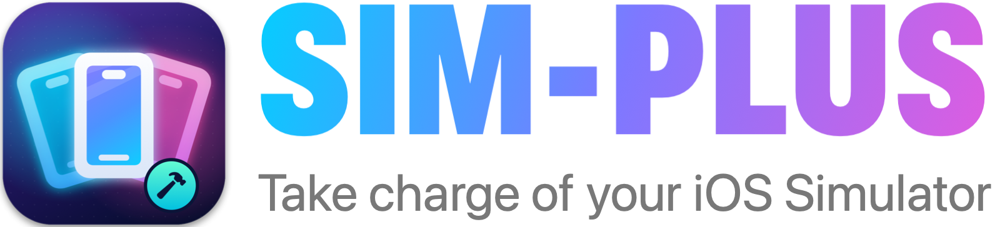

    

Control Room is a macOS app that lets you control the simulators for iOS, tvOS, and watchOS – their UI appearance, status bar configuration, and more. It wraps Apple’s own **simctl** command-line tool, so you’ll need Xcode installed

You’ll need Xcode 27 or later to build and use Control Room on your Mac

## Installation

To try Control Room yourself, download the code and build it through Xcode. It’s built using SwiftUI, so you’ll need macOS Big Sur in order to run it. You will also need Xcode installed, because it relies on the **simctl** command being present – if you see an error that you’re missing the command line tools, go to Xcode's Preferences, choose the Locations tab, then make sure Xcode is selected for Command Line Tools

## Features

Control Room is packed with features to help you develop apps more effectively, including:

- Taking screenshots and movies, optionally adding the device bezels to your screenshots
- Adjusting the system time and date to whatever you want, including Apple’s preferred 9:41
- Controlling status of WiFi, cellular service, and battery
- Opening the data folder for your app, or editing your `UserDefaults` entries
- Overriding dark or light mode, language, accessibility options, and Dynamic Type content size
- Picking a custom user location from anywhere in the world
- Starting, stopping, installing, and removing apps
- Sending test push notifications or triggering deep links
- Selecting colors from the simulator, converting them to UIKit or SwiftUI code, or even dragging directly into your asset catalog

Plus there’s an optional menu bar icon adding quick actions such as re-sending the last push notification or re-opening your last deep link

## Contribution guide

Any help you can offer with this project is most welcome – there are opportunities big and small so that someone with only a small amount of Swift experience can help

Some suggestions you might want to explore:

- Handle errors in a meaningful way
- Add documentation in the code or here in the README
- Did I mention handling errors in a meaningful way?

You’re also welcome to try adding some tests, although given our underlying use of simctl that might be tricky

If you spot any errors please open an issue and let us know which macOS and Xcode versions you’re using

**Please ensure that SwiftLint returns no errors or warnings before you send in changes**

## Credits
Control Room was originally designed and built by Paul Hudson, and is copyright © Paul Hudson 2023

Many other folks have contributed features, fixes, and more to make Control Room what it is today. Control Room is built on top of Apple’s **simctl** command – the team who built that deserve the real credit here
